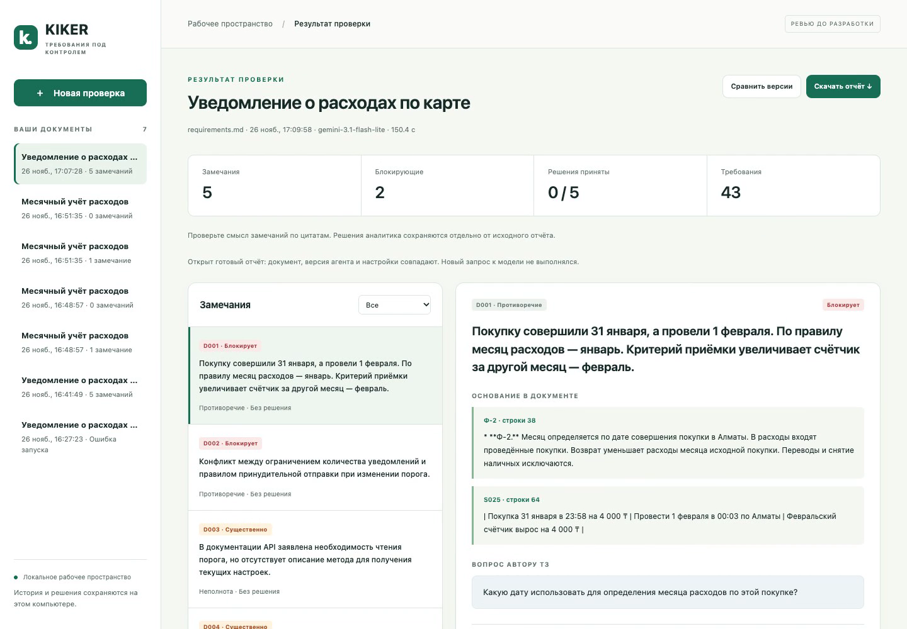

# KIKER · BCC-HUB × MNU FinTech Hackathon

Локальный инструмент ревью финтех-ТЗ перед разработкой: загрузить Markdown/PDF, проверить замечание по цитатам, сохранить решение и сравнить новую редакцию.

- [Код и инструкция запуска · проверенная версия](https://github.com/Nurdaulet362/BCC_HUB_KIKER/tree/e1baa9da76c3ba4be4460c7033440425a8a880c6)
- [Выданное ТЗ](requirements.md) · [Отчёт Gemini](report.md) · [JSON для интерфейса](result.json)
- [Проверки, время и ограничения](QUALITY.md)
- [Демонстрация интерфейса · 96 секунд](demo.mp4) · [Сценарий защиты](DEMO.md)
- [Архитектура](https://github.com/Nurdaulet362/BCC_HUB_KIKER/blob/e1baa9da76c3ba4be4460c7033440425a8a880c6/docs/ARCHITECTURE.md)
- [Протокол пилота](PILOT.md) · [Пустая форма наблюдений](pilot-observations.csv)
- [Манифест и SHA-256](manifest.json)

## Что проверено

На этой версии через Gemini выполнены 18 размеченных сценариев: **18/18 сценариев получили успешный результат**. Для этого выполнено 19 попыток; сбоев API — 1. Неуспешная попытка сохранена отдельно от повтора. Дополнительные повторы январской пары и чистой CSV-выгрузки: **4/4**. Один запрос к тому же Gemini с тем же системным промптом прошёл 3 из 8 основных случаев. Это маленькие наборы, известные разработчику; они подготовлены с помощью ИИ при разработке и не измеряют универсальную точность.

Конфликт покупки 31 января, проведённой 1 февраля, найден. Исправленный короткий документ не получает замечаний, включая перевод с неизменной суммой расходов. Настоящие конфликты перевода, повторной заявки, границы CSV и типов API проверяются отдельными примерами.

В основном полном отчёте: **43 требования, 5 замечаний, 0 отклонённых записей**, время анализа **150.4 с**. Это фактический вывод агента, не независимый эталон дефектов. В `QUALITY.md` опубликованы оба полных прогона, промежуточные неуспешные результаты и сетевые ошибки. Markdown-отчёты вручную не переписывались.

Прошли 44 модульных теста, 9 браузерных проверок, проверки ошибок CLI и запуск на текстовом PDF. Код: `e1baa9da76c3ba4be4460c7033440425a8a880c6`. Модель: Gemini 3.1 Flash-Lite, LOW, temperature 0.

## Просмотр без нового запроса к модели

Установите зависимости и запустите `python -m kiker.web` по инструкции в коде. Скачайте [result.json](result.json) из этой ветки и выберите «Открыть отчёт». Импорт, цитаты, сохранение решения и сравнение сохранённых проверок работают без вызова Gemini. Для нового анализа нужен собственный ключ API в локальном `.env`.

Видео показывает сохранённые реальные результаты. Ожидание Gemini в короткую запись не входит; решение в интерфейсе введено ведущим демонстрации. Пилот с людьми **не проведён**: участников пока нет. Экономия времени аналитика не измерена. Репозиторий остаётся приватным по решению владельца; получение материалов жюри не подтверждено.

