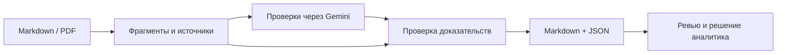

<p align="center">
  
</p>

<h1 align="center">KIKER</h1>

<p align="center"><strong>Ревью требований до разработки — с цитатами и решением по каждому замечанию.</strong></p>

<p align="center">Python · Gemini API · Markdown и PDF · Локальное рабочее пространство</p>

<p align="center">
  <a href="#быстрый-запуск">Запуск</a> ·
  <a href="https://github.com/Nurdaulet362/BCC_HUB_KIKER/blob/submission/demo.mp4">Демо · 96 секунд</a> ·
  <a href="examples/report.md">Настоящий отчёт</a> ·
  <a href="#результаты-проверок">Результаты</a> ·
  <a href="docs/SUBMISSION.md">Материалы для сдачи</a>
</p>


## От противоречия — к согласованному решению

В одном ТЗ бизнес-правило может говорить одно, а критерий приёмки — другое. KIKER помогает системному аналитику найти такие расхождения, проверить исходные фрагменты и задать автору конкретный вопрос.

**Пример из задания хакатона:** покупку совершили **31 января**, а провели **1 февраля**.

| Часть ТЗ | Что в ней сказано |
| --- | --- |
| Бизнес-правило | Месяц расходов определяется по дате совершения покупки. |
| Приёмка | После проведения покупки увеличивается февральский счётчик. |
| Вывод агента | По правилу нужен январь; критерий приёмки выбирает другой месяц. |
| Вопрос автору | Какую дату использовать для определения месяца расходов по этой покупке? |

Формулировки в таблице сокращены. В отчёте сохранены исходные цитаты, номера строк и вопрос к автору ТЗ. Перевод, исключённый из расходов и не меняющий счётчик, не получает замечания в опубликованных контрольных прогонах.

<details>
<summary><strong>Посмотреть замечание и его источники в интерфейсе</strong></summary>


Снимок показывает сохранённый результат Gemini. Его открытие не запускает новый анализ.

</details>

## Что можно сделать

| Действие | Результат |
| --- | --- |
| Загрузить Markdown, текстовый PDF или вставить ТЗ | Найти противоречия, неоднозначности и другие замечания к требованиям. |
| Открыть замечание | Увидеть серьёзность, исходные фрагменты и вопрос к автору. |
| Подтвердить, отклонить или отправить на уточнение | Сохранить решение и комментарий отдельно от вывода модели. |
| Сравнить две проверки | Увидеть новые, сопоставленные и не повторившиеся замечания. |
| Скачать результат | Получить Markdown-отчёт, JSON или отдельный файл решений аналитика. |
| Открыть сохранённый отчёт | Продолжить ревью без повторного запроса к Gemini. |

## Быстрый запуск

Нужен **Python 3.11–3.14**. Для нового анализа также нужны интернет и ключ Gemini. Для просмотра сохранённого примера ключ не требуется. Node.js нужен только для необязательных браузерных тестов.

### 1. Установить

Команды для macOS / Linux:

```sh
git clone https://github.com/Nurdaulet362/BCC_HUB_KIKER.git
cd BCC_HUB_KIKER
python3 -m venv .venv
source .venv/bin/activate
python -m pip install -r requirements.txt
cp .env.example .env
```

Репозиторий приватный: для клонирования нужен предоставленный владельцем доступ. [Установка на Windows](docs/RUNNING.md#установка-на-windows).

### 2. Подключить Gemini

Создайте ключ в [Google AI Studio](https://aistudio.google.com/apikey) и впишите его в локальный `.env`:

```dotenv
GEMINI_API_KEY=YOUR_GEMINI_API_KEY
```

Остальные значения уже указаны в `.env.example`. Ключ используется сервером и не попадает в браузер. При просмотре готового примера этот шаг можно пропустить.

### 3. Запустить агент одной командой

Из корня репозитория, с активированным окружением:

```sh
python -m kiker examples/requirements.md report.md --json result.json
```

Это **выданное организаторами ТЗ**, включённое в репозиторий без изменений. Прогресс выводится в терминал; результат появится в `report.md` и `result.json`. Команда выполняет новый анализ через Gemini. Путь к своему `.md` или `.pdf` можно передать вместо `examples/requirements.md`.

### Или открыть интерфейс

```sh
python -m kiker.web
```

Откройте **[http://127.0.0.1:8765](http://127.0.0.1:8765)**. Прикрепите ТЗ через «+» или вставьте текст, затем нажмите кнопку со стрелкой.

**Попробовать без API-ключа:** нажмите «Открыть отчёт» слева и выберите [`examples/result.json`](examples/result.json). Вы получите настоящий сохранённый результат: **43 требования и 5 замечаний**, доступные для ревью. Это демонстрация уже выполненного анализа; время нового запроса в неё не входит.

## Как работает агент



Gemini проверяет формулировки, бизнес-правила, приёмку и интерфейсы. Затем отдельный проход проверяет основания замечаний: обязательное действие, возможный сценарий, противоречащие результаты и правило, которое уже могло отвечать на вопрос.

Python проверяет структуру ответа, существование источников, точность цитат и повторы. Для поддерживаемых таблиц дополнительно сверяются явные месяцы покупки и числовые итоги исключённых операций. Для противоречия требуются два разных источника с противоположными результатами.

[Архитектура и обработка сбоев](docs/ARCHITECTURE.md) · [Настройки и CLI](docs/RUNNING.md) · [Дизайн интерфейса](docs/UI_DESIGN.md)

## Результаты проверок

Опубликованная серия использует **Gemini 3.1 Flash-Lite · LOW · temperature 0**. Успех контрольного случая требует найти все размеченные конфликты, не добавить лишних замечаний и не оставить отклонённых записей.

| Проверка | Фактический результат |
| --- | --- |
| Основные 8 сценариев | KIKER **8/8**, один запрос к тому же Gemini — **3/8**. |
| Основной, расширенный набор и случаи типов | **18 сценариев** получили успешный результат за **19 попыток**. Один сбой API сохранён отдельно от успешного повтора. |
| Дополнительные повторы январской пары и чистого CSV | **4/4** успешных прогона. |
| Полное выданное ТЗ | **43 требования, 5 замечаний** в каждом из двух прогонов. Отклонённых записей: **0** и **1**. |
| Время двух полных прогонов | **150,4 с** и **73,5 с**, включая ожидание и сетевые повторы. |
| Модульные тесты | **44** прошли на версии интерфейса `2743c63`. |
| Браузерные сценарии | **12** прошли на версии интерфейса `5d7749c`, включая мобильную навигацию, сохранение решений и неизменность скачанного отчёта. |

В основном наборе медианное время KIKER — **31,38 с**, одного запроса — **2,86 с**. Дополнительные проверки стоят времени и запросов; сравнение опубликовано вместе с исходными результатами.

**Границы этих чисел:** это небольшие регрессионные наборы, подготовленные с помощью ИИ и известные разработчику. Они не измеряют универсальную точность на новых банковских документах. Человеческий пилот ещё не проведён, экономия времени аналитика не измерена.

Версия анализа — [`e1baa9d`](https://github.com/Nurdaulet362/BCC_HUB_KIKER/tree/e1baa9da76c3ba4be4460c7033440425a8a880c6). Последующие изменения интерфейса и документации не выдаются за новые прогоны модели. Все цифры, ошибки API, повторы и ограничения — в [отчёте качества](https://github.com/Nurdaulet362/BCC_HUB_KIKER/blob/submission/QUALITY.md).

## Данные и ограничения

- История, исходники и решения хранятся локально в `.kiker-runs/`. **При новом анализе текст документа передаётся в Gemini API.**
- Сервер слушает `127.0.0.1`. Авторизация пользователей и общий сервер для команды в текущий прототип не входят.
- PDF должен содержать текстовый слой; встроенного OCR нет.
- Точные цитаты подтверждают источник, но не гарантируют правильность вывода модели. Финальное решение принимает аналитик.
- «Замечание не повторилось» при сравнении требует проверки новой редакции документа человеком.

## Навигация по проекту

| Путь | Что внутри |
| --- | --- |
| [`kiker/`](kiker/) | Агент на Python, Gemini-клиент, парсинг, верификация и отчёты. |
| [`kiker/static/`](kiker/static/) | Интерфейс на HTML, CSS и JavaScript. |
| [`examples/`](examples/) | Выданное ТЗ и неизменённые результаты реального прогона. |
| [`tests/`](tests/) | Модульные и браузерные проверки. |
| [`evals/`](evals/) | Контрольные сценарии и сравнение с одним запросом к модели. |
| [`docs/`](docs/) | Архитектура, запуск, сценарий демо и подготовка сдачи. |
| [Ветка `submission`](https://github.com/Nurdaulet362/BCC_HUB_KIKER/tree/submission) | Полные доказательства: отчёты, трассы, видео, контрольные суммы и история проверок. |

## Проверить самостоятельно

```sh
python -m unittest discover -s tests -v
```

Модульные тесты не требуют живого вызова Gemini. [Браузерные проверки](docs/RUNNING.md#браузерная-проверка) используют сохранённые отчёты; [оценка качества](evals/README.md) выполняет новые запросы к модели и расходует квоту API.

---

Разработано для **BCC-HUB × Maqsut Narikbayev University Hackathon**. [Задание организаторов](https://github.com/BCC-HUB/ai-requirements-validator-task) · [Материалы для сдачи](docs/SUBMISSION.md) · [Протокол будущего пилота](docs/PILOT.md)
