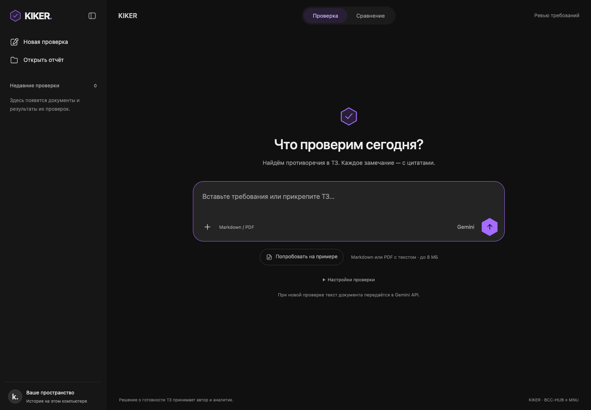

<p align="center"></p>

<h1 align="center">KIKER · материалы для жюри</h1>

<p align="center"><strong>Проверка ТЗ с исходными цитатами и решениями аналитика.</strong></p>

<p align="center">
  <a href="https://github.com/Nurdaulet362/BCC_HUB_KIKER/tree/ee8f220044d7e72f76a88f477d288b1c512ed78f">Код и запуск</a> ·
  <a href="demo.mp4">Демо · 96 секунд</a> ·
  <a href="report.md">Отчёт Gemini</a> ·
  <a href="QUALITY.md">Проверки качества</a>
</p>



## С чего начать

| Материал | Что проверить |
| --- | --- |
| [Код и README](https://github.com/Nurdaulet362/BCC_HUB_KIKER/tree/ee8f220044d7e72f76a88f477d288b1c512ed78f) | Установка, команда запуска, архитектура и примеры. |
| [Выданное ТЗ](requirements.md) → [Отчёт](report.md) | Реальные замечания агента, исходные цитаты и паспорт прогона. |
| [JSON-результат](result.json) | Открыть в интерфейсе без нового запроса к модели. |
| [Видео](demo.mp4) · [Сценарий](DEMO.md) | Ревью, решение по цитатам и сравнение короткой контрольной пары. |
| [QUALITY.md](QUALITY.md) | Все серии, неуспешные попытки, время и ограничения. |
| [Манифест](manifest.json) | Версии и SHA-256 файлов комплекта. |

**Пример:** правило относит покупку 31 января к январским расходам, а приёмка после проведения 1 февраля увеличивает февральский счётчик. KIKER показывает оба источника и задаёт вопрос автору. Корректный перевод с неизменной суммой не получает замечания в опубликованных контрольных прогонах.

<details>
<summary><strong>Посмотреть результат проверки</strong></summary>


</details>

## Воспроизвести анализ

Код находится в основной ветке. После [установки и настройки `.env`](https://github.com/Nurdaulet362/BCC_HUB_KIKER/blob/ee8f220044d7e72f76a88f477d288b1c512ed78f/README.md#быстрый-запуск) выполните из её корня:

```sh
python -m kiker examples/requirements.md report.md --json result.json
```

Выданное ТЗ уже включено в `examples/`. Для просмотра готового результата запустите `python -m kiker.web`, нажмите «Открыть отчёт» и выберите `examples/result.json`. Импорт работает без API-ключа и обозначается как сохранённый результат.

## Что подтверждено

| Проверка | Результат |
| --- | --- |
| Основной набор | KIKER **8/8**, один запрос к тому же Gemini — **3/8**. |
| Все три набора | **18 сценариев** с успешным результатом за **19 попыток**; один сбой API сохранён отдельно от повтора. |
| Дополнительные повторы | **4/4**: январская пара и чистая CSV-выгрузка. |
| Полное выданное ТЗ | **43 требования и 5 замечаний** в обоих прогонах; отклонённых записей **0** и **1**. |
| Время полных прогонов | **150,4 с** и **73,5 с**. |
| Интерфейс | **12** браузерных проверок на версии `5d7749c`. |
| Модульные тесты | **44** прошли на версии `2743c63`. |

Это небольшие наборы, подготовленные с помощью ИИ и известные разработчику. Они не измеряют универсальную точность на новых ТЗ. В основном наборе медиана времени KIKER — 31,38 с, одного запроса — 2,86 с. [Все цифры и условия сравнения](QUALITY.md).

Пилот с людьми **не проведён**, экономия времени аналитика не измерена. Подготовлены [протокол](PILOT.md) и [форма наблюдений](pilot-observations.csv).

## Сдача через форму

[Готовые значения полей и инструкция](https://github.com/Nurdaulet362/BCC_HUB_KIKER/blob/ee8f220044d7e72f76a88f477d288b1c512ed78f/docs/SUBMISSION.md). В поле репозитория укажите [https://github.com/Nurdaulet362/BCC_HUB_KIKER](https://github.com/Nurdaulet362/BCC_HUB_KIKER); для файла отчёта используйте [report.md](report.md), созданный агентом без ручного редактирования.

Репозиторий остаётся приватным; для сдачи требуется предоставить доступ жюри. Доступ пока не подтверждён. Поле видео необязательное: текущая запись длится 96 секунд и показывает сохранённые результаты, а форма описывает 3–5 минут с запуском и процессом анализа на Loom, YouTube или Google Drive. Подходящая внешняя ссылка пока не подготовлена.

## Происхождение материалов

- Код с новым README и примерами: `ee8f220044d7e72f76a88f477d288b1c512ed78f`. Эта итерация меняет документацию и комплект примеров; новых запросов Gemini не выполнялось.
- Интерфейс и запись демо: `5d7749c4e6499b85ce9a2a93f3b56aa2fe8a51d6`. [Проверки дизайна](UI.md).
- Анализ: `e1baa9da76c3ba4be4460c7033440425a8a880c6`, Gemini 3.1 Flash-Lite, LOW, temperature 0.
- Вход, Markdown-отчёт и JSON сохранены побайтно. [Происхождение примеров](https://github.com/Nurdaulet362/BCC_HUB_KIKER/blob/ee8f220044d7e72f76a88f477d288b1c512ed78f/examples/README.md).
- Видео — автоматическая запись настоящего интерфейса с синтезированной русской озвучкой. Решение в кадре введено ведущим демонстрации; это не пользовательский пилот. [Озвучка](NARRATION.md).

Полная история доказательств — в [validation/](validation/README.md). Отсутствие замечания модели не заменяет согласование ТЗ человеком.
