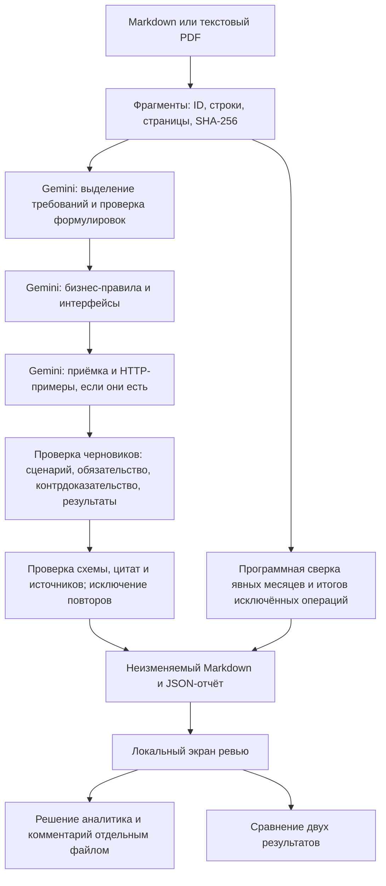

# Как устроен KIKER

Цель — получить проверяемое замечание и решение аналитика до передачи ТЗ в разработку. Gemini анализирует смысл; Python управляет проходами, проверяет структуру доказательств, выполняет ограниченные сверки таблиц и собирает результат. Это один управляемый конвейер с несколькими ролями анализа.

## Проверяемость вывода

У каждого замечания есть исходные фрагменты и вопрос к автору. Для противоречия нужны два разных источника и две цитаты обязательных результатов. Модель должна проверить, не основан ли сценарий на неуказанном предположении и не отвечает ли на вопрос уже существующее правило. Разница между бизнес-состоянием и кодированием поля не считается конфликтом типов.

Код проверяет существование и буквальное содержание цитат с нормализацией оформления. Это не доказывает логический вывод модели. Программная сверка даты покупки/проведения и исключённой операции работает только для поддерживаемых явных формулировок. [Анализ](../kiker/audit.py) · [Сверка приёмки](../kiker/acceptance.py)

## Работа пользователя и хранение

| Данные | Где находятся | Назначение |
| --- | --- | --- |
| API-ключ | Локальный `.env` или переменная процесса | Только серверные запросы Gemini |
| Извлечённый текст и контекст | Передаются Gemini при новом анализе | Анализ требований |
| Вход, результат и паспорт | Локальная `.kiker-runs` | История и воспроизводимость |
| Решения и комментарии | Отдельный JSON внутри папки проверки | Не изменяют исходный результат модели |
| Учебные отчёты и измерения | Приватная ветка `submission` | Проверка жюри |

Сервер слушает `127.0.0.1`. Записи решений проверяют ревизию, чтобы вкладка не перезаписала чужое изменение молча. Импортированные отчёты обозначаются как сохранённые. Повторное использование готового результата допускается только при совпадении байтов документа, версии кода, модели и настроек; его можно отключить. Проверочные серии всегда вызывают Gemini заново. [Рабочее пространство](../kiker/web.py) · [Формат и сравнение](../kiker/snapshot.py)

## Сбои и ограничения

Сетевые и временные HTTP-сбои получают ограниченные повторы. При ошибке отчёт не выдаётся за завершённую проверку. Дневной лимит останавливает серию. Публикуются время, запросы, ошибки и версия каждого прогона.

Сравнение помечает замечание как «не повторилось», но не объявляет дефект исправленным. Экономия времени человека и переносимость качества на новые банковские документы требуют отдельного пилота и независимой разметки. [Протокол пилота](PILOT.md) · [Проверки качества](../evals/README.md)
